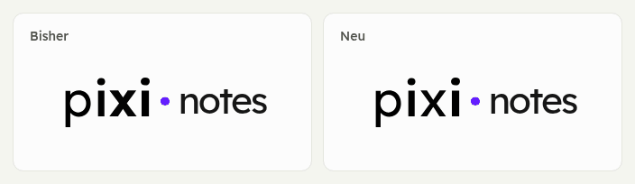

# M560 — Tintenfluss auf festem Stamm in der Agency-Wortmarke

2026-11-27

In der bisherigen Wortmarke rückte die linke Kante des „p“ in der Kopfleiste um rund 2,6 Pixel nach links. Diese Bewegung entsprach bei 25 Pixeln Schriftgröße fast der Breite des ruhenden Stamms. Außerdem änderten die i-Punkte im Lauf der Welle ihre Größe.

Der linke Stamm des „p“ steht jetzt fest. Zuerst sammelt sich Tinte an der linken Innenwand. Die Öffnung weicht nach rechts oben aus, dann fließt ein Teil der Tinte an den rechten Rand. Die Rundung unter dem Bauch läuft in einen schlanken Fuß aus. Das „x“ hat schmalere Diagonalen. Beide i-Punkte stehen, während sich die Flanken ihrer Stämme wölben und zurückziehen.

## Umsetzung und Prüfung

In `src/assets/pixi-logo.json` bewegt eine eigene Lottie-Gruppe die Öffnung des „p“ innerhalb der Außenkontur. Die beiden Bewegungen überlagern sich. Stamm und i-Punkte gleichen den seitlichen Versatz der ursprünglichen VAVE-Ebenen aus. Die Buchstaben setzen weiterhin nacheinander ein. Der Vergleich zeigt den ersten Bewegungszyklus mit seiner regulären Dauer von 14,2 Sekunden.

`pruefungen/m560-agency-fluss.mjs` prüft bei 22 und 25 Pixeln Schriftgröße die Position des p-Stamms und beider i-Punkte sowie den Richtungswechsel der Öffnung. M554 und M557 prüfen zusätzlich die Lesbarkeit der Konturen während der Bewegung.
